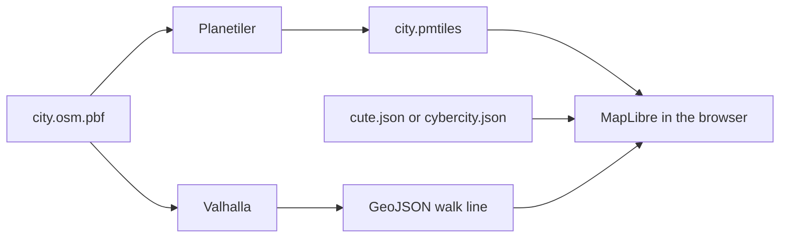

# Technical design

This is how [DESIGN.md](DESIGN.md) is built. The repository still has no map code. The first version is a static page. MapLibre draws in the browser, and the tiles are a file.

## Stack

| Piece | Choice | Role |
| --- | --- | --- |
| Extract | Geofabrik `.osm.pbf` | One region of OpenStreetMap |
| Tiles | Planetiler, OpenMapTiles profile, output PMTiles | Turns the extract into vector tiles |
| Map | MapLibre GL JS | Draws the tiles with WebGL |
| Tile access | `pmtiles` protocol | Reads byte ranges over HTTP |
| Paint | Two MapLibre style JSON files plus one sprite each | Cute and cybercity |
| Visitor cut | Filters and layer visibility inside those styles | Which features are drawn |
| Walk | Valhalla, built from the same PBF | Foot route and duration |
| Page | Static `index.html` | Loads the map. No application server |

`tile.openstreetmap.org` is not a source. Those images are already painted, and that service is for light browsing.

Next.js is not part of this version. The page does not render on a server. A later site with neighborhood pages can wrap this same client map.

## Pipeline



Planetiler is run once per extract, not on each page view. The command takes the PBF path and writes `city.pmtiles`. The OpenMapTiles profile emits these source layers: `water`, `landuse`, `park`, `building`, `transportation`, `transportation_name`, `poi`, and `place`. A feature keeps `class`, `subclass`, and `name`. The rest of the OSM tags are dropped at build time.

The PMTiles file is served by any HTTP host that supports `Range` requests. The browser asks for the bytes of the tiles in view. There is no tile daemon.

## Page

`index.html` creates one `maplibregl.Map`. The vector source id is `osm`.

```js
map.addSource("osm", {
  type: "vector",
  url: "pmtiles://city.pmtiles"
})
```

The page opens on a neighborhood center stored next to the extract, as longitude, latitude, and zoom. It does not open on the world.

A control switches paint. Before the swap the page reads center, zoom, and bearing. It calls `setStyle` with the other JSON file. On `style.load` it restores that camera, the selected place, and the walk line. The place did not change. Only the style document did.

The attribution control is always on and includes `© OpenStreetMap contributors`. Both themes use it.

## Style documents

`styles/cute.json` and `styles/cybercity.json` share layer ids, source id `osm`, and source-layer names. They differ in `paint`, `layout`, and the sprite URL.

A road layer:

```json
{
  "id": "roads",
  "type": "line",
  "source": "osm",
  "source-layer": "transportation",
  "filter": ["!", ["in", "class", "service", "track"]],
  "layout": { "line-cap": "round", "line-join": "round" },
  "paint": { "line-color": "#f4b4c8", "line-width": 2 }
}
```

The cybercity document uses the same filter and sets `line-color` to a neon value on a dark `background` layer. Landuse and buildings follow the same pattern: one layer id, two paint blocks.

Icons live in `sprites/cute` and `sprites/cybercity`. The style points at its own sprite. A cafe is `icon-image` from that sheet. The name is `["get", "name"]`. The text font, size, and halo are the only label changes.

## Visitor cut

Visitor mode is a boolean on the page, default on. It does not load a third tile file. The page sets layout visibility and relies on filters already in the style.

| Layer id | Visitor on | Visitor off |
| --- | --- | --- |
| `roads` | foot, path, pedestrian, residential, primary | the style's full road filter |
| `buildings` | hidden | shown |
| `road-numbers` | hidden | shown |
| `places` | `class` in cafe, restaurant, park, museum, bus, rail | every `poi` class the style allows |

`places` is a symbol layer on source-layer `poi`:

```json
{
  "id": "places",
  "type": "symbol",
  "source": "osm",
  "source-layer": "poi",
  "filter": ["in", "class", "cafe", "restaurant", "park", "museum", "bus", "rail"],
  "layout": {
    "icon-image": "pin",
    "text-field": ["get", "name"]
  }
}
```

Toggling visitor mode updates those layer filters and visibilities on the current style. It does not call `setStyle`, so the paint stays.

A tap on `places` reads `name`, `class`, and the feature point from the event. The card shows those two fields. Walking minutes are filled when the route call returns. The raw OSM tags are not on the tile. A later tile build can keep a small `tags` property if a detail view needs them. The first build does not.

## Walk line

Valhalla is loaded with the same PBF and configured for pedestrian costing. The page sends the current location and the selected point to a `/route` endpoint on that service. Each point is a `[longitude, latitude]` pair. The response is a GeoJSON `LineString` and a duration in seconds. The page divides seconds by 60 and rounds to a minute count. The line is a GeoJSON source named `route`, drawn with the accent color of the active theme (`#e89aaa` for cute, `#ff4fd8` for cybercity). Replacing the line is `setData` on that source.

The browser calls Valhalla only if that host sends an open CORS header. Otherwise a few-line proxy is added later. The first static page can ship with the route source empty and the card showing name and class only.

The line is the geometry Valhalla returns from OSM foot ways. The page does not straighten it or add roads.

## "You are here"

The page uses the browser geolocation API once when the visitor allows it. The result is a one-point GeoJSON source named `here`, drawn with the theme's marker. Denial leaves the source empty and the map stays on the neighborhood center.

## First build

1. Choose one Geofabrik region and record its center.
2. Run Planetiler on that PBF and commit nothing under the tile file. The PMTiles output is large and stays a build artifact.
3. Add `index.html`, `styles/cute.json`, `styles/cybercity.json`, and the two sprites.
4. Serve the directory with any static host that supports range requests. Confirm both paints and the visitor toggle on that one city.

Valhalla and the card's walking minutes are the step after the two paints are visible.

## Out of scope

Search, accounts, saved views, and a tile server are out of scope. The page does not write back to OpenStreetMap. Theme changes are local style files.
